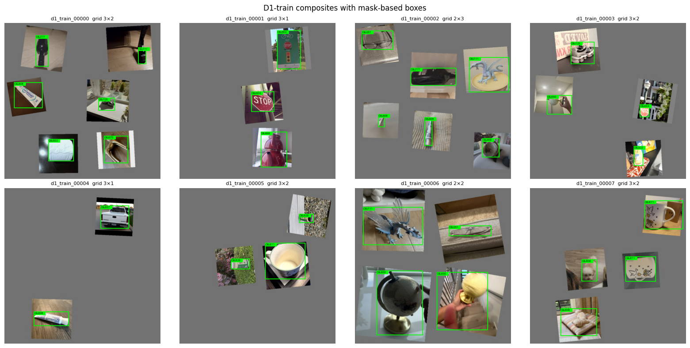
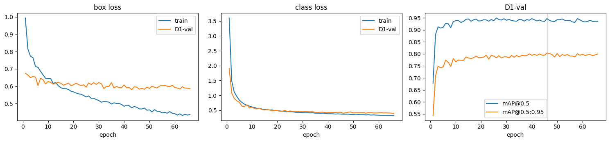
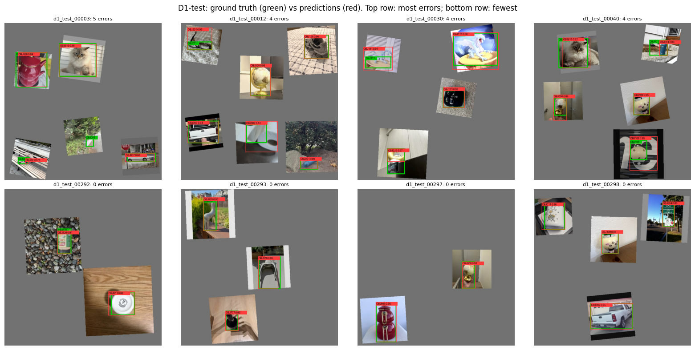

# M2 — Multi-Object Images and YOLOv8 Detection

IE 7615 Discriminative Deep Learning Project · Milestone 2 · Oct 27, 2026

## 1. Task

M2 has three requirements: (1) generate at least 100 multi-object images by concatenating randomly selected single-object images, as train and test sets for object detection; (2) custom-train YOLOv8 to detect the objects; (3) given a multi-object image, output the ID and location of every object. All 20 classes of the shared dataset are used. Implementation: `m2/m2_detection.ipynb`, run `m2_20261027_123730` on Google Colab (Tesla T4). The run is identified by its checksums and records.

## 2. Data

**Source images and split.** M2 reuses the M1 split unchanged: `split_manifest.csv` (1,416 / 303 / 303 images, near-duplicates grouped by pHash so that a group never crosses splits) and `classes.json` (index 0–19 ↔ course ID). Both files matched the checksums recorded in M1, and all 2,022 source files matched their M1 md5. Each detection set was generated **only from the matching source split**: D1-train from train images, D1-val from val images, D1-test from test images. The generator verified that no source image is used in two sets (train 1,355, val 291 and test 293 distinct source images used).

**Object boxes from masks.** Using the whole 224×224 tile as the box would teach the detector where photo tiles are, not where objects are. Every source image was segmented with rembg (`u2net`) and cleaned (morphological opening, small parts removed, holes filled). An automatic check flagged 83 masks (2 empty, 76 covering <2% of the image, 9 with more than 3 parts); these were excluded, leaving **1,939 usable source images**. Every class kept images in every split and passed the per-split floors (lowest: OBJ001 with 49 / 12 / 8 images in train / val / test). The M1 split itself was not changed.

**Grid concatenation (D1).** Each 640×640 composite holds 2–6 objects (average 4) in a grid from 2×1 to 3×2. Each chosen cell receives one whole source photo, with its own background kept, plus horizontal flip (p = 0.5), color jitter (brightness, contrast and saturation ±20%), rotation ±10° and a size of 70–100% of the cell at a random position. The mask goes through exactly the same flip, rotation and resize, and the label is the **tight box of the transformed mask** in YOLO format. A placement is rejected if its visible box is under 12 px per side or less than 30% visible; no placement had to be skipped. A class-balanced sampler makes every class appear equally often (spread between the most and least frequent class: 0.3% of the mean in train, 1.7% in val and test).

| Set | Source split | Images | Objects | Objects / image |
|---|---|---|---|---|
| D1-train | train | 1,500 | 5,990 | 3.99 |
| D1-val | val | 300 | 1,208 | 4.03 |
| D1-test | test | 300 | 1,154 | 3.85 |



## 3. Model and training

YOLOv8n (3.1 M parameters, 8.7 GFLOPs) was initialized from COCO-pretrained weights (transfer learning; the 80-class head is replaced by a 20-class head), following the Lecture 3 YOLO demo. Training used image size 640, batch 16 and Ultralytics' default optimizer and augmentation (mosaic, HSV, flips, scale/translate; mosaic off for the last 10 epochs), for up to 100 epochs with early stopping (patience 20) on D1-val. Training stopped after 66 epochs (24.4 min on a T4). The kept checkpoint is epoch 46, the best by Ultralytics' fitness on D1-val (0.1·mAP@0.5 + 0.9·mAP@0.5:0.95), which is also the best epoch by mAP@0.5:0.95 alone. Validation mAP levels off after about 15 epochs; afterwards the validation box loss stays near 0.6 while the training box loss keeps falling, a sign of mild overfitting that early stopping limits.



**Confidence threshold.** The threshold was chosen on D1-val only and saved before testing: the value in 0.05–0.95 that maximizes macro-F1 over the 20 classes (a detection counts if it has the right class and IoU ≥ 0.5 with a not-yet-matched ground-truth box). Result: **0.50**.

## 4. Results

| Set | mAP@0.5 | mAP@0.5:0.95 | Precision @0.5 | Recall @0.5 | Macro-F1 @0.5 |
|---|---|---|---|---|---|
| D1-val | 0.948 | 0.804 | 0.943 | 0.935 | 0.938 |
| **D1-test** | **0.908** | **0.738** | **0.895** | **0.892** | **0.890** |

**Per class (D1-test).** 15 of 20 classes reach AP@0.5 ≥ 0.89, and 8 reach ≥ 0.99 (OBJ108 is just below at 0.880). Four classes are clearly weaker:

| Class | AP@0.5 | AP@0.5:0.95 | F1 | Likely reason |
|---|---|---|---|---|
| OBJ001 | 0.438 | 0.335 | 0.431 | The bottle is photographed from far away and covers only a small part of each photo, so in a grid cell it is only a few tens of pixels. Many of its masks are correct but cover <2% of the image, so the automatic check excluded 31 of its 100 images |
| OBJ111 | 0.650 | 0.341 | 0.719 | Masks often cover only part of the object, so the ground-truth box is smaller than the object the model finds |
| OBJ004 | 0.827 | 0.542 | 0.719 | Stop sign with a car filling much of the photo; confused with OBJ007 (pickup truck), the same error as the M1 classifier |
| OBJ529 | 0.851 | 0.656 | 0.872 | Partly confusion with OBJ002 (2 cases) |

Figure 3 shows example test composites with the ground-truth boxes and the predictions.



**Output format (requirement 3).** For any input image the model returns the course ID, confidence and box (pixel coordinates of the input image) of every object. Example for test composite `d1_test_00298.jpg` (ground truth: OBJ108, OBJ011, OBJ007, OBJ004; all four found):

```json
{"image": "d1_test_00298.jpg", "objects": [
  {"object_id": "OBJ011", "confidence": 0.957, "box_xyxy": [32.1, 56.5, 127.7, 167.7]},
  {"object_id": "OBJ004", "confidence": 0.890, "box_xyxy": [524.3, 52.4, 574.0, 156.2]},
  {"object_id": "OBJ108", "confidence": 0.935, "box_xyxy": [275.1, 169.2, 344.8, 265.7]},
  {"object_id": "OBJ007", "confidence": 0.946, "box_xyxy": [231.5, 467.2, 403.3, 573.2]}]}
```

## 5. Discussion and limitations

- **In-distribution test.** D1-test is built exactly like the training data (same grid layout, whole photos on a gray canvas), so mAP@0.5 = 0.908 is an in-distribution score. It does not show how the detector behaves on real cluttered photos or overlapping objects; M3 adds a harder copy-paste test set and real photos of OBJ011 for this.
- **Validation–test gap.** mAP@0.5 drops from 0.948 (val) to 0.908 (test). Both sets are built the same way but from different source photos, with only about 15 test photos per class, so per-class AP depends heavily on a few photos.
- **Mask quality.** The masks were checked automatically only; the 83 flagged masks were excluded without review. The "<2% area" rule removed correct masks of small objects (mostly OBJ001), and some accepted masks cover only part of the object, which lowers the measured localization accuracy. Reviewing the flagged masks (keeping the correct small ones) and re-segmenting partial masks with SAM are the next steps.
- **Shortcuts.** Class-specific framing seen in M1 (black or white borders, solid backgrounds) is copied into the composites with each tile, so it can still act as a cue.
- **One run, one seed.**

## 6. Files

`m2_detection.ipynb` (executed). Run folder `IE7615_project/runs/m2_20261027_123730/`: `data/` (mask manifest, D1 records and manifests, `d1.yaml`, dataset zip), `models/d1_yolov8n_best.pt`, `records/` (`selection.json`, `run_yolov8n_d1.json`, `test_run_log.jsonl`, `example_output.json`), `figures/`, `demo_examples/`, `M2_results_for_report.md`.
